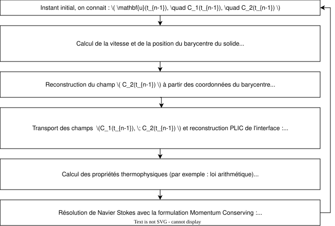

## Algorithme de résolution au sein d'un pas de temps $\Delta t$:

{fig-align="center"}

## Formulation Momentum Conserving (@ELOUAFA2026)

1. **Interpolation** : La densité $\rho_{\text{eff}}$ (obtenue par la VOF) est interpolée vers les faces des cellules. On obtient la densité exacte sur la grille décalée, notée $\rho_{\text{eff}}^n$.
2. **Synchronisation initiale** : Calcul de la quantité de mouvement aux faces $(\rho_{\text{eff}} \mathbf{u})^n$.
3. **Transport prédictif** : Transport de la masse et de la quantité de mouvement pour obtenir les champs prédictifs $\rho_{\text{eff}} ^\star$ et $(\rho_{\text{eff}} \textbf{u})^\star$ (via un intégrateur temporel très stable de type SSP-RK3) : 
$$
\frac{\partial \rho_{\text{eff}} ^\star}{\partial t} + \nabla \cdot (\rho_{\text{eff}} ^\star \mathbf{u}) =0 \qquad (\text{On résout pour} \; \mathbf{\rho_{\text{eff}} ^\star})
$$
$$
\frac{\partial (\rho_{\text{eff}} \mathbf{u})^\star}{\partial t} + \nabla \cdot ((\rho_{\text{eff}} \mathbf{u})^\star \otimes \mathbf{u}) = \mathbf{0} \qquad (\text{On résout pour} \; \mathbf{(\rho_{\text{eff}} \mathbf{u})^\star})
$$

4. **Résolution de la physique** : Insertion de $\rho_{\text{eff}} ^\star$ et $(\rho_{\text{eff}} \textbf{u})^\star$ dans le terme inertiel de Navier-Stokes. Le système de type Stokes résout ensuite la vraie vitesse $\mathbf{u}^{n+1}$ et la pression $p^{n+1}$ :
$$
\frac{\rho_{\text{eff}}^\star \mathbf{u}^{n+1} - (\rho_{\text{eff}}\mathbf{u})^\star}{\Delta t} = - \nabla p^{n+1} + \nabla \cdot [\mu_{\text{eff}}(\nabla \mathbf{u}^{n+1} + (\nabla \mathbf{u}^{n+1})^T)] + \rho_{\text{eff}}^\star \mathbf{g}
$$
$$
\nabla \cdot \mathbf{u}^{n+1} = 0
$$ 