## Contexte : une pollution plastique croissante

<div style="height: 1.7em;"></div>

::: columns

::: {.column width="50%"}

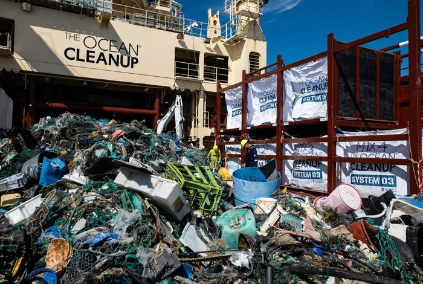{width=100%}

<div style="text-align: center; font-size: 0.8em;">
Déchets plastiques collectés par The Ocean Cleanup lors d’une extraction.
</div>

:::

::: {.column width="50%"}

<div style="height: 2em;"></div>

<div style="
  width: 100%;
  margin: 0 auto;
  background-color: #e3f2fd;
  border: 2px solid #90caf9;
  padding: 10px 22px;
  border-radius: 10px;
">

Depuis les années 1950, la production mondiale de plastique ne cesse d'augmenter.

<div style="height: 1em;"></div>

<div style="font-size: 1em; font-weight: bold;">
4–12 millions de tonnes de déchets plastiques atteignent les océans chaque année.
</div>

<div style="height: 1em;"></div>

Cette pollution menace la **faune** et les **écosystèmes marins**.

<div style="height: 0.5em;"></div>
</div>

:::

:::


<div style="
  width: 75%;
  margin: 0 auto;
  background-color: #e8f5e9;
  border: 2px solid #81c784;
  padding: 10px 30px;
  border-radius: 12px;
  text-align: center;
  line-height: 1.6;
">

<strong>→ Comprendre et limiter le transport des déchets plastiques est un enjeu majeur.</strong>

</div>

<div style="height: 0.5em;"></div>

<div style="font-size: 0.75em;">

Sources : @WALKER2023116984, @Lebreton, @BARBOZA2018336

</div> 

## Des solutions de collecte à grande échelle

L'ONG **The Ocean Cleanup** développe des dispositifs permettant de collecter les déchets plastiques.

::: columns

::: {.column width="50%"}

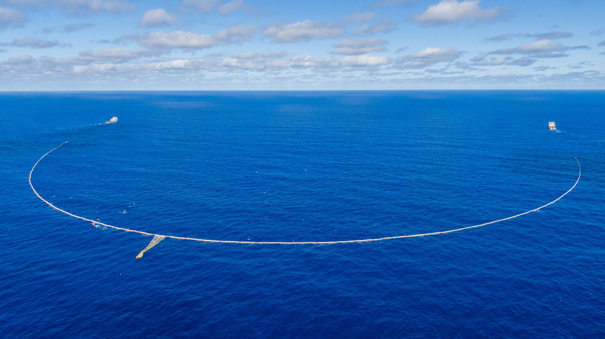{width=100%}

<div style="text-align: center; font-size: 0.8em;">
Barrière flottante en forme de U, déployée en océan
</div>

:::

::: {.column width="50%"}

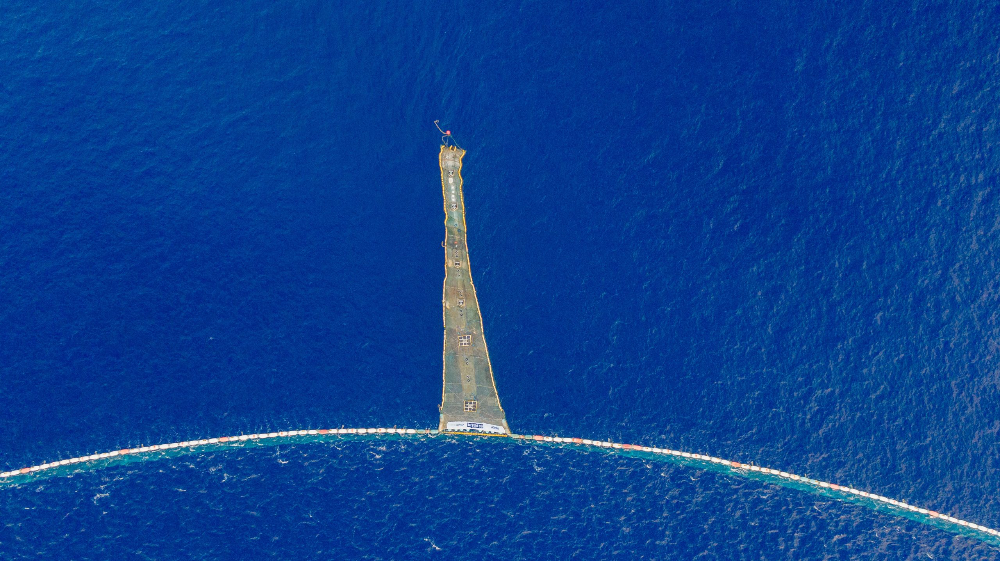{width=100%}

<div style="text-align: center; font-size: 0.8em;">
Zone de rétention des plastiques
</div>

:::

:::


<div style="height: 0.5em;"></div>

<div style="
  width: 88%;
  margin: 0 auto;
  background-color: #e3f2fd;
  border: 2px solid #90caf9;
  padding: 10px 22px;
  border-radius: 10px;
  text-align: center;
  font-weight: bold;
">
Performance maximale rapportée : <strong>75kg/h</strong> en 2023 ----- Plastique extrait en 2024 : <strong>143 993 kg</strong>
</div>

<div style="height: 1em;"></div>

<div style="
  width: 70%;
  margin: 0 auto;
  background-color: #e8f5e9;
  border: 2px solid #81c784;
  padding: 10px 30px;
  border-radius: 12px;
  text-align: center;
  line-height: 1.6;
">

<strong>→ Des solutions permettent de collecter les plastiques à grande échelle.</strong>

</div>

<div style="font-size: 0.75em;">

Sources : The Ocean Cleanup

</div> 

## Prédire le transport des plastiques : un défi

<div style="height: 1.2em;"></div>

<div style="text-align: center; font-size: 1.05em;">

Les déchets flottants sont soumis simultanément à plusieurs
<br>
phénomènes environnementaux :

<div style="height: 1em;"></div>

<div style="display: flex; justify-content: center; gap: 18px;">

<div style="
  background-color: #e3f2fd;
  border: 2px solid #90caf9;
  padding: 12px 22px;
  border-radius: 10px;
  font-weight: bold;
">
Courants marins
</div>

<div style="
  background-color: #e3f2fd;
  border: 2px solid #90caf9;
  padding: 12px 22px;
  border-radius: 10px;
  font-weight: bold;
">
Vent
</div>

<div style="
  background-color: #e3f2fd;
  border: 2px solid #90caf9;
  padding: 12px 22px;
  border-radius: 10px;
  font-weight: bold;
">
Marées
</div>

<div style="
  background-color: #fff3e0;
  border: 2px solid #ff9800;
  color: #e65100;
  padding: 12px 22px;
  border-radius: 10px;
  font-weight: bold;
">
Vagues
</div>

</div>

<div style="height: 1.2em;"></div>

<div style="
  display: inline-block;
  background-color: #f5f5f5;
  border-left: 5px solid #f5f5f5;
  padding: 10px 25px;
  border-radius: 8px;
  font-size: 1.05em;
">

→ <strong>Prédiction des trajectoires très complexe</strong>


</div>

<div style="height: 1.8em;"></div>

<div style="
  width: 95%;
  margin: 0 auto;
  background-color: #e8f5e9;
  border: 2px solid #81c784;
  padding: 18px 22px;
  border-radius: 12px;
  text-align: center;
  line-height: 1.6;
">

<strong>→ Pour améliorer la collecte, il est nécessaire de mieux comprendre le transport des plastiques.</strong>

<strong>→ On s'intéresse à l'influence des vagues sur ce transport.</strong>


</div>

</div>

## Cadre général : Théorie des ondes : dérive de Stokes

::: columns

::: {.column width="55%"}

<div style="height: 2em;"></div>

<div style="
  width: 88%;
  margin: 0 auto;
  background-color: #e3f2fd;
  border: 2px solid #90caf9;
  padding: 10px 22px;
  border-radius: 10px;
">

Une vague progressive génère un **mouvement orbital** des particules
fluides.

<div style="height: 0.6em;"></div>

Une vague de Stokes est **non linéaire**, le mouvement orbital est **asymétrique**. La trajectoire n'est **pas parfaitement fermée** 

</div>
<div style="height: 0.6em;"></div>
<div style="
  width: 88%;
  margin: 0 auto;
  background-color: #e8f5e9;
  border: 2px solid #81c784;
  padding: 18px 30px;
  border-radius: 12px;
  text-align: center;
  line-height: 1.6;
">
→ La particule présente un déplacement net dans la direction
de propagation de la vague.


</div>

:::

::: {.column width="45%"}

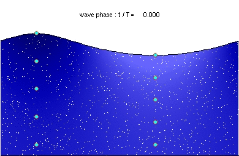{width=100%}

<div style="text-align: center; font-size: 0.75em;">
Déplacement net de particules dans une vague de Stokes
</div>

:::

:::

<div style="height: 0.6em;"></div>

<div style="
  width: 50%;
  margin: 0 auto;
  background-color: #e8f5e9;
  border: 2px solid #81c784;
  padding: 18px 30px;
  border-radius: 12px;
  text-align: center;
  line-height: 1.6;
">
<strong>→ Ce déplacement net est appelé <em>dérive de Stokes</em>.</strong>

</div>

<div style="height: 2em;"></div>

<div style=" font-size: 0.7em;">
Sources : @thual2005ondes, @guyon2012hydrodynamique
</div>
<div style=" font-size: 0.7em;">
Vidéo prise de : @enwiki:1372664558
</div>

## Fil conducteur du stage : stratégie en 4 étapes 

<div style="height: 0.3em;"></div>

<div style="
  width: 95%;
  margin: 0 auto;
  background-color: #e8f5e9;
  border: 2px solid #81c784;
  padding: 18px 30px;
  border-radius: 12px;
  text-align: center;
  line-height: 1.6;
">
<strong>Objectif : étudier et quantifier la dérive de Stokes d'un objet flottant (taille finie) en interaction avec une vague de Stokes.</strong>

</div>

<div style="height: 0.7em;"></div>

```{=html}
<div style="display: flex; gap: 1.5rem; align-items: flex-start;">

  <div style="flex: 1; text-align: center;">

    <p style="margin-bottom: 5px;">
      <strong>1. Étude préliminaire : prise en main du code de calcul</strong>
    </p>

    <video autoplay loop muted playsinline width="50%">
      <source src="videos/solide.mp4" type="video/mp4">
    </video>

    <p style="font-size: 0.9em;">
      Diphasique (eau / solide)
    </p>

  </div>


  <div style="flex: 1; text-align: center;">

    <p style="margin-bottom: 5px;">
      <strong>2. Paramétrage et validation du solveur</strong>
    </p>

    <div style="height: 1.3em;"></div>

    <video autoplay loop muted playsinline width="50%">
      <source src="videos/cylindre_2.mp4" type="video/mp4">
    </video>

    <p style="font-size: 0.9em;">
      Triphasique (air / eau / solide)
    </p>

  </div>


  <div style="flex: 1; text-align: center;">

    <p style="margin-bottom: 5px;">
      <strong>3. Implémentation et validation d'une vague de Stokes</strong>
    </p>

    <video autoplay loop muted playsinline width="50%">
      <source src="videos/vague3emeordre.mp4" type="video/mp4">
    </video>

    <p style="font-size: 0.9em;">
      Diphasique (eau / air)
    </p>

  </div>


  <div style="flex: 1; text-align: center;">

    <p style="margin-bottom: 5px;">
      <strong>4. Quantification de la dérive de Stokes de l'objet</strong>
    </p>

    <video autoplay loop muted playsinline width="50%">
      <source src="videos/out3.mp4" type="video/mp4">
    </video>

    <p style="font-size: 0.9em;">
      Triphasique (air / eau / solide)
    </p>

  </div>

</div>
```

## Equations régissant la dynamique du problème en présence de particule

$$
\nabla\cdot \mathbf{u} =0 \quad \forall \mathbf{x} \in \Omega_{\text{tot}}$$
$$
{\color{red}{\rho_{\text{eff}}}} \left( \frac{\partial \mathbf{u}}{\partial t} + \mathbf{u} \cdot \nabla \mathbf{u} \right) = -\nabla p + \nabla \cdot \left[ {\color{red}{\mu_{\text{eff}}}} (\nabla \mathbf{u} + \left(\nabla \mathbf{u}\right)^T) \right] + {\color{red}{\rho_{\text{eff}}}} \mathbf{g} \quad \forall \mathbf{x} \in \Omega_{\text{tot}}
$$
$$
\mathbf{u} = \mathbf{U} + \boldsymbol{\omega} \times \mathbf{OM} \quad \forall \mathbf{x} \in \Omega_p
$$

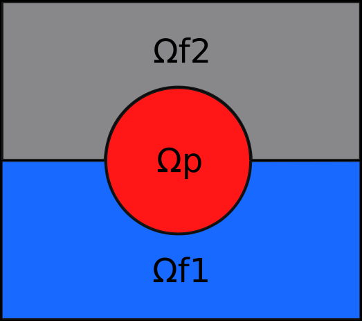{fig-align="center"}

<div style="text-align: center;">

Représentation de $\Omega_{\text{tot}}$

</div>

## Modélisation et transport des phases 

- On introduit deux champs de fraction volumique $C_1$ et $C_2$ :

::: {.text-center}
$$
C_1 = 
  \begin{cases}
 1 & \text{dans l'eau} \\
 0<C_1<1 & \text{à l'interface} \\
 0 & \text{ailleurs}
  \end{cases} 
\qquad \text{et}\qquad
C_2 = 
  \begin{cases}
 1 & \text{dans le solide} \\
 0<C_2<1 & \text{à l'interface} \\
 0 & \text{ailleurs}
 \end{cases}
$$
:::

- On transporte deux champs de fraction volumique :

$$ \frac{\partial C_1}{\partial t} + \mathbf{u} \cdot \nabla C_1 = 0 \qquad \frac{\partial C_2}{\partial t} + \mathbf{u} \cdot \nabla C_2 = 0
$$

:::: {.columns}

::: {.column width="25%"}
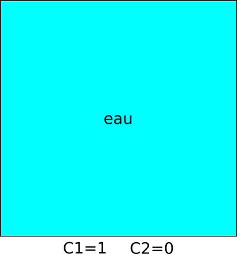{height=350px fig-align="center"}

:::

::: {.column width="25%"}
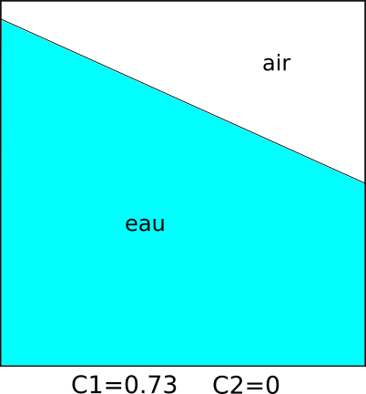{height=350px fig-align="center"}

:::

::: {.column width="25%"}
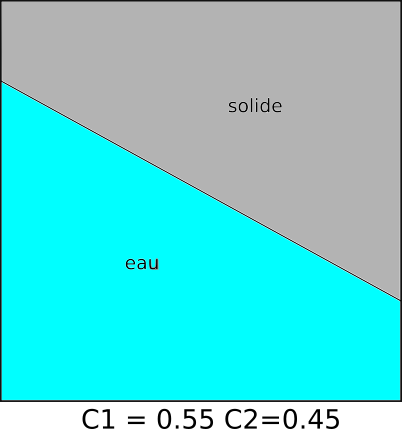{height=350px fig-align="center"}

:::

::: {.column width="25%"}
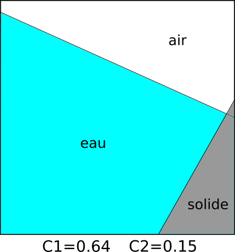{height=350px fig-align="center"}

:::

::::

## Lois de mélange des propriétés physiques

**Loi arithmétique pour la densité effective :**
$$
{\color{red}{\rho_{\text{eff}}}} = (1-C_1-C_2)\rho_{\text{air}} + C_1 \rho_{\text{eau}} + C_2 \rho_{\text{solide}}
$$

**Plusieurs lois de mélange testés pour la viscosité effective : **

<br>

**Loi arithmétique :**
$$
{\color{red}{\mu_{\text{eff}}}} = (1-C_1-C_2)\mu_{\text{air}} + C_1 \mu_{\text{eau}} + C_2 \mu_{\text{solide}}
$$

**Loi harmonique :**
$$
{\color{red}{\mu_{\text{eff}}}} = \frac{\mu_{\text{air}} \mu_{\text{eau}} \mu_{solide}}{(1-C_1-C_2)\mu_{\text{eau}} \mu_{\text{solide}} + C_1 \mu_{\text{air}}\mu_{\text{solide}} + C_2 \mu_{\text{air}} \mu_{\text{eau}}}
$$
**Loi géométrique :**
$$
{\color{red}{\mu_{\text{eff}}}} = \mu_{\text{air}}^{(1-C_1-C_2)}  \mu_{\text{eau}}^{C_1}  \mu_{\text{solide}}^{C_2}
$$


## Mouvement de corps rigide : pénalisation tensorielle

Dans la région solide on résout :

$$
{\color{blue}{\rho_{\text{solide}}}} \left( \frac{\partial \mathbf{u}}{\partial t} + \mathbf{u} \cdot \nabla \mathbf{u} \right) = -\nabla p + \nabla \cdot \left[ {\color{blue}{\mu_{\text{solide}}}} (\nabla \mathbf{u} + (\nabla \mathbf{u})^T) \right] + {\color{blue}{\rho_{\text{solide}}}} \mathbf{g}
$$

- Si on fait tendre $\mu_{\text{solide}} \to \infty$, on résout :

$$\nabla \cdot [\underline{\underline{\mathbf{D}}}(u)]=0$$

- C'est équivalent à résoudre : 

$$
\underline{\underline{\mathbf{D}}}(u)=0
$$

- C'est équivalent à imposer un mouvement de corps rigide :

$$
\mathbf{u} = \mathbf{U} + \boldsymbol{\omega} \times \mathbf{OM} 
$$

<div style=" font-size: 0.7em;">
Sources : @patankar2000, @sharma2005, @CALTAGIRONE2001607
</div>


## Le code de calcul : Fugu

::: {.columns style="display: flex; align-items: center;"}

::: {.column width="60%"}

<div style="height: 5em;"></div>

- Développé par l'équipe **TCM** du laboratoire MSME

- Basé sur la méthode des **volumes finis** et sur la résolution des équations de Navier-Stokes

- Ecrit en **Fortran 90** 

- Parallélisé avec **MPI** pour le calcul haute performance (HPC)
:::

::: {.column width="40%"}
<div style="height: 5em;"></div>

{width="60%" fig-align="center"}
:::

:::

<div style="height: 5em;"></div>

<div style=" font-size: 0.7em;">

Articles de référence : @VINCENT2014582, @VINCENT2008898, @fluids6010023

</div>


<div style="text-align:center; margin-top:2vh;">

# Paramétrage et Validation du solveur multiphasique

</div>

## Expérience de laboratoire de référence (@Ito1977)

:::: {.columns}
::: {.column width="50%"}
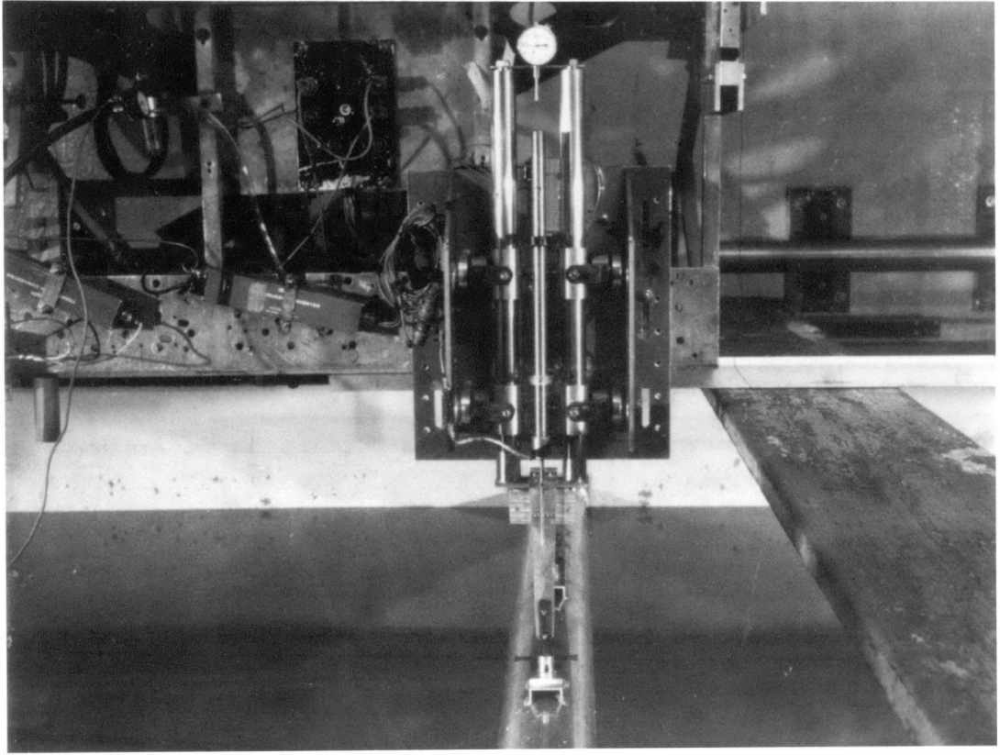{fig-align="center" height="500px"}
:::
::: {.column width="50%"}
| Paramètre | Valeur |
|:---------|:------:|
| Diamètre du cylindre (D)| 0.1524 m |
| **Longueur** du bassin| 27.432 m **(180 D)** |
| **Longueur** du cylindre | 2.5908 m **(17 D)** |
| Hauteur du bassin | 1.22 m |
| Déplacement initial $h_1$ | 0.0254 m **(0.16 D)**  |

: Caractéristiques du bassin de l'expérience {#tbl-tank_properties}
:::
::::

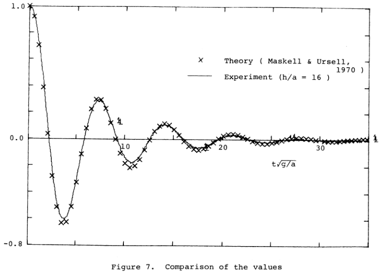{fig-align="center" height="450px"}


## Modélisation Numérique

:::: {.columns}
::: {.column width="50%"}
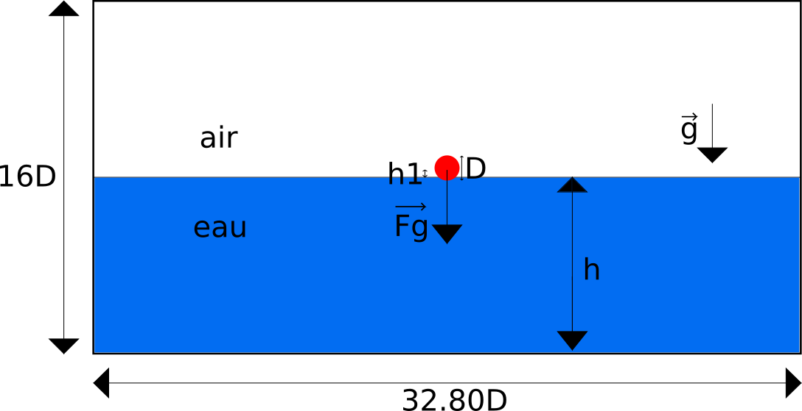{fig-align="center"}

:::
::: {.column width="50%"}

```{=html}
<div style="flex: 1; text-align: center;">
    <video autoplay loop muted playsinline style="width: 100%; max-width: 800px;">
      <source src="videos/oscillation.mp4" type="video/mp4">
    </video>
</div>
```

:::
::::

<div style="height: 1.0em;"></div>

<div style="flex: 1; text-align: center;">
**Théorie des ondes (validité des résultats)** :
</div>

$$
c=\sqrt{gd} = 3.46 \; \text{m/s}
$$
$$
t_{valide}=\frac{L}{\sqrt{gd}}=\frac{32.80D}{\sqrt{gd}} = 1.44 \; s
$$

## Etude paramétrique du problème 


```{=html}
<div style="flex: 1; text-align: center;">
    <video autoplay loop muted playsinline style="width: 100%; max-width: 800px;">
      <source src="videos/oscillation.mp4" type="video/mp4">
    </video>
</div>
```


::: {style="text-align: center;"}
**3 paramètres à étudier :**

1. **Loi de mélange de la viscosité effective** : (arithmétique, harmonique, géométrique)
2. **Valeur de la viscosité pénalisante $\mu_\text{solide}$**
3. **Résolution du maillage** (On note $N=\frac{D}{\Delta x}$ le nombre de mailles par diamètre du cylindre)
:::


## Influence de la loi de mélange de la viscosité 

<div style="height: 3em;"></div>

```{=html}
<div style="display: flex; justify-content: center; gap: 20px;">
  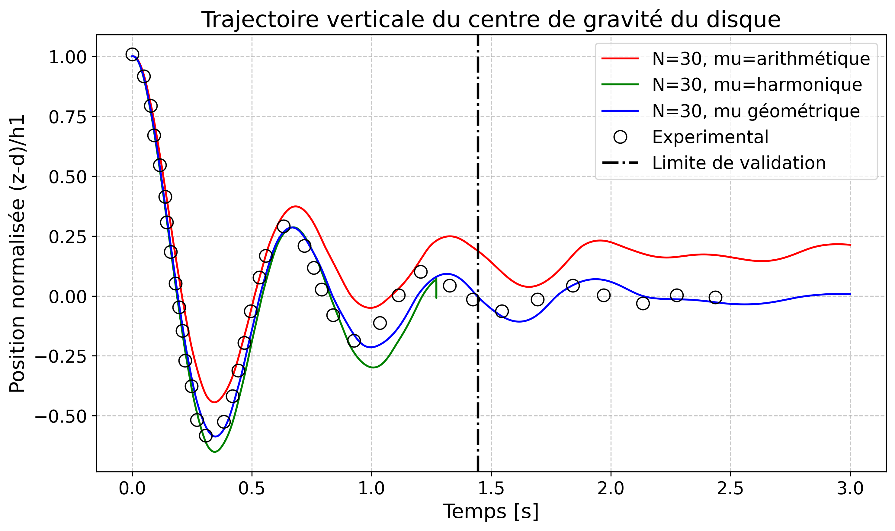
  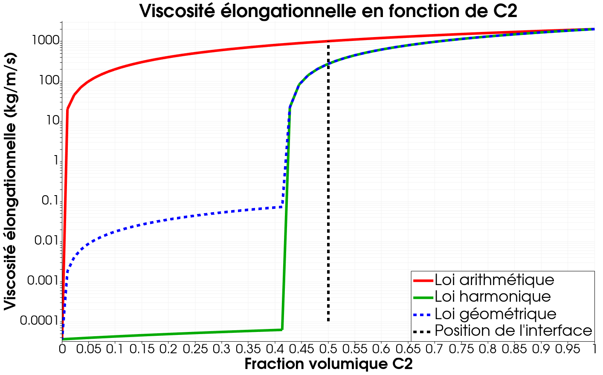
</div>
```


## Influence de la viscosité pénalisante $\mu_\text{solide}$

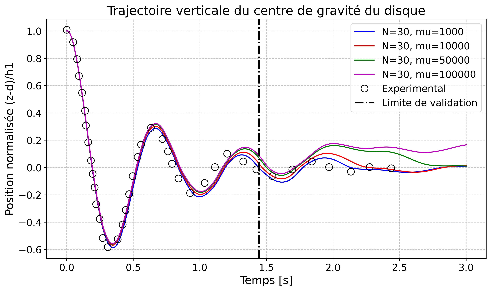{fig-align="center"}


## Influence de la viscosité pénalisante $\mu_\text{solide}$ (suite)

$$
\scriptsize
\text{Erreur : } \alpha = \vert h_{2\text{ref}}-h_{2\text{num}}\vert \qquad \text{Norme } L_p \text{ de l'erreur } \alpha : \Vert \alpha \Vert_p = \left( \frac{1}{t_{\text{valide}}}\int_0^{t_{\text{valide}}} \alpha (t)^p\,dt \right)^{\frac{1}{p}} \qquad \text{Norme } L_\infty \text{ de l'erreur } : \Vert \alpha \Vert_\infty = \text{sup}(\alpha)
$$

$$
\scriptsize
\text{On trace :} \frac{\Vert \alpha \Vert_1}{\Vert h_{2\text{ref}} \Vert_1}, \; \frac{\Vert \alpha \Vert_2}{\Vert h_{2\text{ref}} \Vert_2}   \; \text{et} \; \frac{\Vert \alpha \Vert_\infty}{\Vert h_{2\text{ref}} \Vert_\infty} \text{ en fonction de } \mu_{\text{solide}} \; \text{pour} \; t \in [0,t_{\text{valide}}]
$$

:::: {.columns}
::: {.column width="50%"}
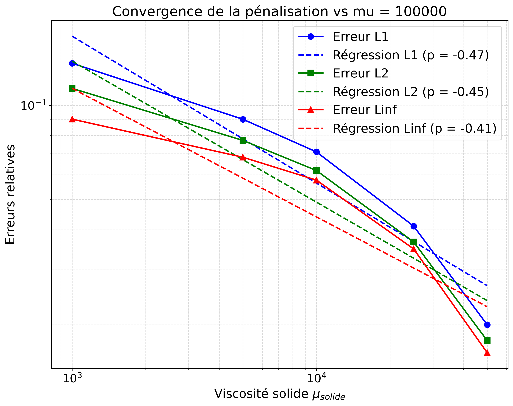{fig-align="center" width="100%"}
:::
::: {.column width="50%"}
::: {style="font-size: 80%;"}
| $\mu_\text{solide}$ | Erreur relative $L_1$ (%) | Erreur relative $L_2$ (%) | Erreur relative $L_\infty$ (%) |
|:-------------------:|:--------------------------:|:--------------------------:|:--------------------------------:|
| 1000  | 13,6 | 11,3 | 9,1 |
| 5000  | 9,0  | 7,7  | 6,8 |
| 10000 | 7,1  | 6,2  | 5,7 |
| 25000 | 4,1  | 3,6  | 3,5 |
| 50000 | 2,0  | 1,7  | 1,6 |

: Erreurs relatives en fonction de $\mu_\text{solide}$ vis-à-vis de $h_{2\text{ref}}$ {#tbl-erreurs-mu-solide}
:::
:::
::::


## Etude de convergence en maillage

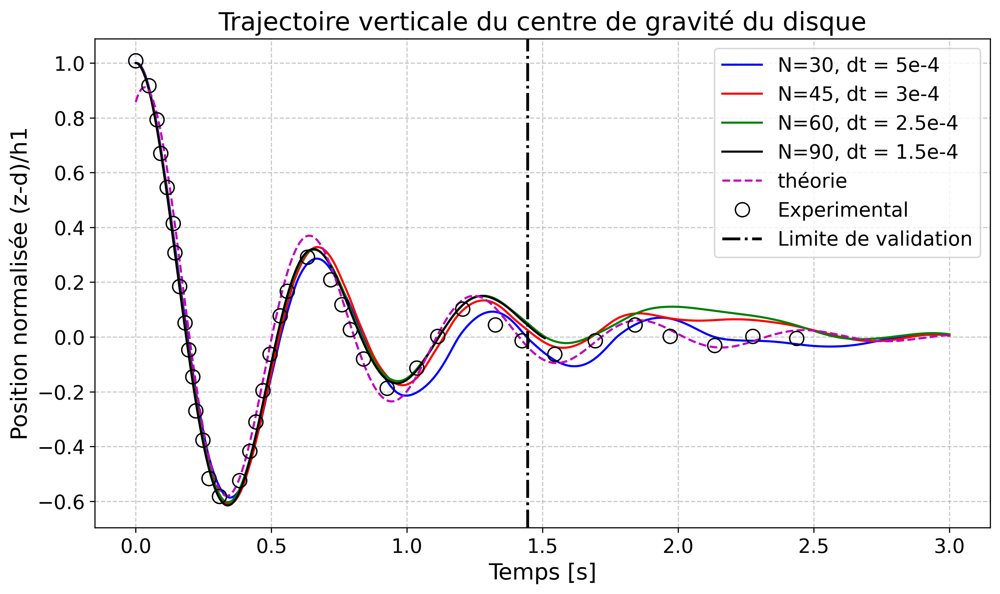{fig-align="center"}

## Etude de convergence de maillage (suite)
$$
\scriptsize
\text{Erreur : } \alpha = \vert h_{2\text{Richardson}}-h_{2\text{num}}\vert \qquad \text{On trace :} \frac{\Vert \alpha \Vert_1}{\Vert h_{2\text{Richardson}} \Vert_1}, \; \frac{\Vert \alpha \Vert_2}{\Vert h_{2\text{Richardson}} \Vert_2}   \; \text{et} \; \frac{\Vert \alpha \Vert_\infty}{\Vert h_{2\text{Richardson}} \Vert_\infty} \text{ en fonction de } \Delta x \; \text{pour} \; t \in [0,t_{\text{valide}}]
$$


:::: {.columns}
::: {.column width="60%"}
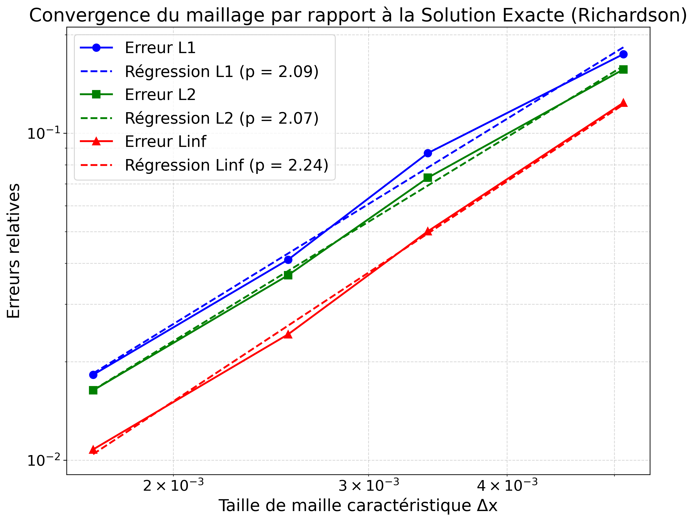{fig-align="center" width="100%"}
:::
::: {.column width="40%"}
::: {style="font-size: 80%;"}
| Mailles / diamètre | Erreur relative $L_1$ (%) | Erreur relative $L_2$ (%) | Erreur relative $L_\infty$ (%) |
|:------------------:|:-------------------------:|:-------------------------:|:-------------------------------:|
| 30 | 17,45 | 15,66 | 12,39 |
| 45 | 8,69  | 7,30  | 5,01 |
| 60 | 4,10  | 3,68  | 2,42 |
| 90 | 1,82  | 1,63  | 1,08 |

: Erreurs relatives en fonction du maillage vis-à-vis de $h_{2\text{Richardson}}$ {#tbl-convergence-maillage}
:::
:::
::::


<div style="text-align:center; margin-top:2vh;">

# Implémentation et validation d'une vague de Stokes
```{=html}
<div style="display: flex; justify-content: center;">
  <video autoplay loop muted playsinline width="1200">
    <source src="videos/vague_3eme_grand.mp4" type="video/mp4">
  </video>
</div>
``` 

</div>

## Validation de la forme de la vague

- Validation de la vague numérique vis à vis du  profil théorique après 3 périodes de simulation, avec 

$$T= \frac{2\pi}{\omega} = \frac{2\pi}{\sqrt{gk\left[1+(ka)^2\right]}}$$


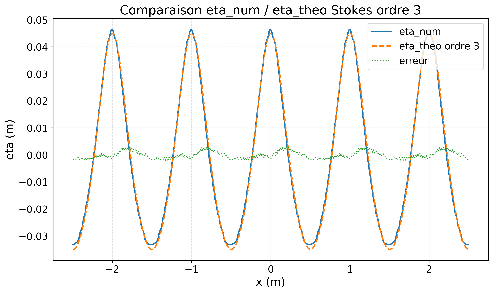{fig-align="center"}


## Etude de convergence en maillage après 3 périodes de vague

:::: {.columns}
::: {.column width="35%"}

$$Re_\lambda=\frac{\lambda \sqrt{g\lambda}}{\nu_f} \sim 3 \times 10^6$$

::: {style="font-size: 80%;"}


<div style="text-align:center; margin-top:2vh;">

| Mailles / Hauteur de vague | Erreur relative $L_1$ (%) | Erreur relative $L_2$ (%) | Erreur relative $L_\infty$ (%) |
|---|---|---|---|---|---|
| 8 |  10,5 | 11 | 14 |
| 16 |  4,6 | 4,8 | 6,5 |
| 24 |  2,21 | 2,37 | 3,69 |
| 32 |  2,27 | 2,4 | 3,15 |
| 40 |  1,77 | 2,0 | 2,98 |
| 48 | 1,8 | 1,95 | 2,66 |
| 64 | 1,69 | 1,85 | 2,44 |
</div>

:::

:::
::: {.column width="65%"}
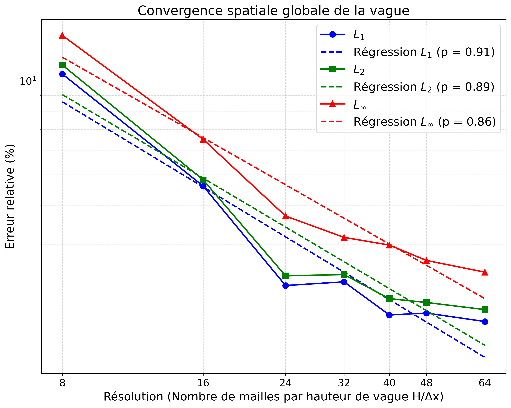{fig-align="center"}

:::
::::


<div style="text-align:center; margin-top:2vh;">

# Quantification de la dérive de Stokes d'une particule flottante

</div>

## Quantification de la dérive de Stokes

:::: {.columns}

::: {.column width="50%"}
<div style="text-align: center;">
**1. Théorie : particule fluide (sans masse)**
</div>

::: {style="background-color: #e3f2fd; padding: 20px; border-radius: 15px; margin-top: 15px; text-align: center; box-shadow: 2px 2px 8px rgba(0,0,0,0.1);"}
**Dérive de Stokes théorique**

$$ U_{S, \text{theo}} = a^2 k \omega \frac{\cosh[2 k(z_0+h)]}{2 \sinh^2(k h)} $$

<span style="font-size: 0.75em; color: #555;">Limite en eau profonde : $U_{S, \text{theo}} = a^2 k \omega \exp(2 k z_0)$</span>
:::

{width=85% fig-align="center"}

:::

::: {.column width="50%"}
<div style="text-align: center;">
**2. Pratique : objet flottant (masse et taille finie)**
</div>

::: {style="background-color: #ffebee; padding: 20px; border-radius: 15px; margin-top: 15px; text-align: center; box-shadow: 2px 2px 8px rgba(0,0,0,0.1);"}
**Dérive de Stokes de l'objet**

$$ U_{S,O} = \overline{U_{L,O}} - \overline{U_E} $$

<span style="font-size: 0.75em; color: #555;">$\overline{U_{L,O}}$ : vitesse lagrangienne moyenne de l'objet</span>
<br>
<span style="font-size: 0.75em; color: #555;">$\overline{U_E}$ : vitesse eulérienne moyenne du courant de fond</span>

:::

<div style="height: 3em;"></div>

<div style="text-align: center;">
  <video autoplay loop muted playsinline width="100%" height="auto" style="border-radius: 10px; box-shadow: 2px 2px 8px rgba(0,0,0,0.2);">
    <source src="videos/simulation.mp4" type="video/mp4">
  </video>
</div>

:::

::::

## Quantification de la vitesse lagrangienne moyenne ($\overline{U_{L,O}}$)

```{=html}
<div style="display: flex; justify-content: center; gap: 20px;">
  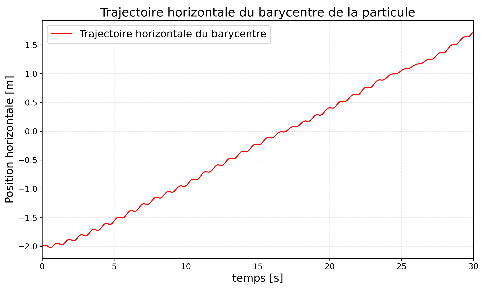
  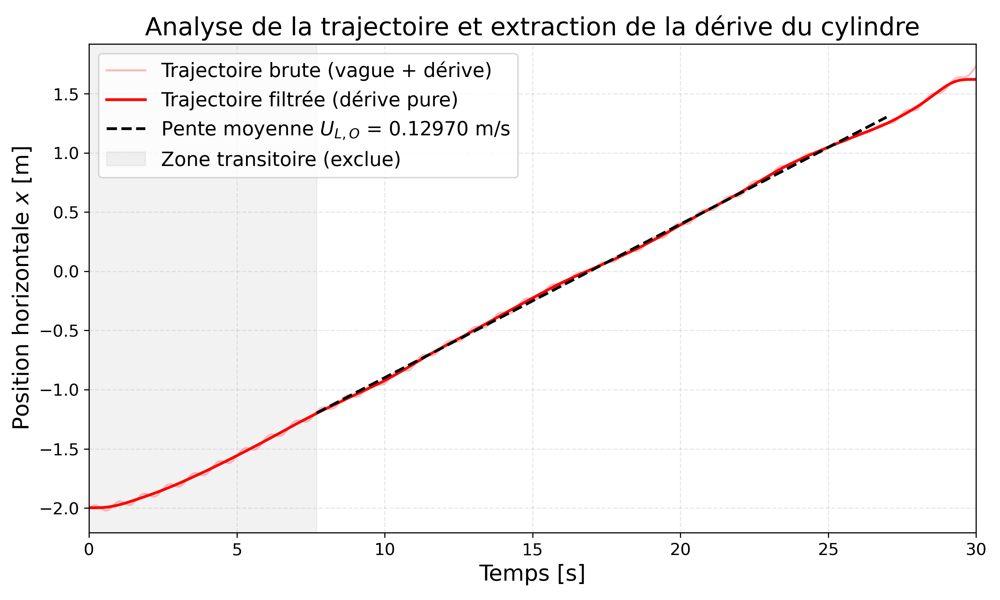
</div>
```

<div style="height: 1em;"></div>

::: {style="display: flex; justify-content: space-around; align-items: center; background-color: #ffebee; padding: 15px; border-radius: 10px; font-size: 0.9em; box-shadow: 2px 2px 8px rgba(0,0,0,0.1); width: 90%; margin: 0 auto;"}
<div><strong>1.</strong> Extraction du barycentre</div>
<div>➔</div>
<div><strong>2.</strong> Filtre passe-bas <br><span style="font-size: 0.75em; color: #555;">(suppression des oscillations)</span></div>
<div>➔</div>
<div><strong>3.</strong> Régression linéaire <br><span style="font-size: 0.75em; color: #555;">(pente = $\overline{\color{red}{U_{L,O}}}$)</span></div>
:::

## Quantification de la vitesse eulérienne ($\overline{U_E}$)

:::: {.columns style="display: flex; align-items: center;"}

::: {.column width="40%"}

<div style="text-align: center;">
  <video autoplay loop muted playsinline width="100%" height="auto" style="border-radius: 10px; box-shadow: 2px 2px 8px rgba(0,0,0,0.2);">
    <source src="videos/out.mp4" type="video/mp4">
  </video>
</div>

:::

::: {.column width="60%"}
<br>

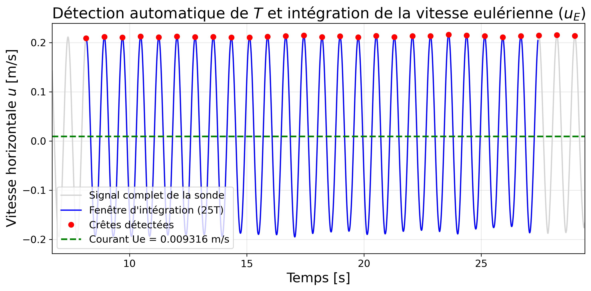{fig-align="center" width="100%"}
:::

::::


::: {style="display: flex; justify-content: space-around; align-items: center; background-color: #e3f2fd; padding: 15px; border-radius: 10px; font-size: 0.9em; box-shadow: 2px 2px 8px rgba(0,0,0,0.1); width: 95%; margin: 0 auto;"}
<div>**1.** Extraction du signal</div>
<div>➔</div>
<div>**2.** Détection des crêtes <br>[*(calcul de la période $T$)*]{style="font-size: 0.75em; color: #555;"}</div>
<div>➔</div>
<div>**3.** Intégration sur $N$ périodes <br>[*(Moyenne = $\overline{\color{blue}{U_E}}$)*]{style="font-size: 0.75em; color: #555;"}</div>
:::

## Influence du diamètre du cylindre sur le facteur d'amplification $\chi$

::: {style="text-align: center; border: 1px solid #ccc; padding: 5px 10px; border-radius: 6px; width: 50%; margin: 0 auto; background-color: #fafafa; font-size: 0.85em;"}

**Comparaison : facteur d'amplification $\chi$**

$$ \chi = \frac{\color{red}{U_{S,O}}}{\color{blue}{U_{S, \text{theo}}}} $$

<span style="font-size: 0.7em; color: #666;">
Quantifie l'écart entre le cylindre et la théorie classique.
</span>

:::

```{=html}
<div style="display: flex; justify-content: center; gap: 20px;">
  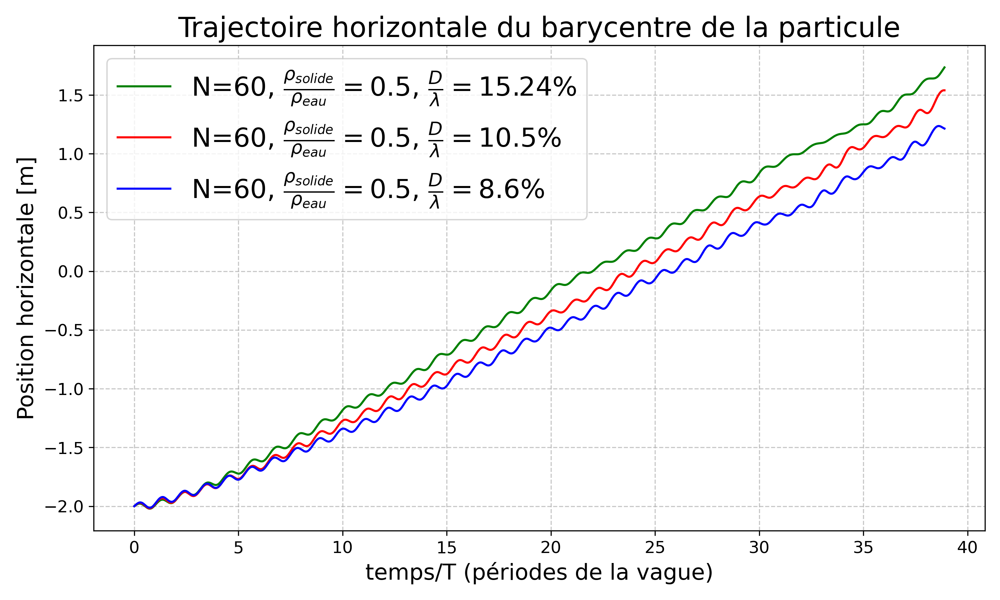
  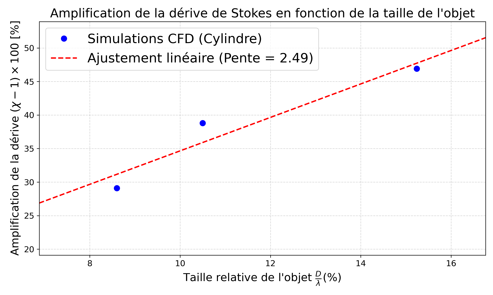
</div>
```


## Conclusion et perspectives


<div style="height: 1em;"></div>

### Bilan : 

<div style="
  width: 100%;
  margin: 0 auto;
  background-color: #e3f2fd;
  border: 2px solid #90caf9;
  padding: 10px 22px;
  border-radius: 10px;
">
- Paramétrage du solveur : Loi de mélange, viscosité pénalisante et maillage convergés

- Implémentation et validation d'une vague de Stokes

- Calcul de la dérive d'un objet flottant de taille finie
</div>

<div style="height: 2em;"></div>


### Perspectives :

<div style="
  width: 100%;
  margin: 0 auto;
  background-color: #e8f5e9;
  border: 2px solid #81c784;
  padding: 10px 22px;
  border-radius: 10px;
">
- Valider la dérive par des expériences en canal ou des simulations CFD de référence

- Étudier l’influence de la densité de l’objet sur la dérive

- Étendre l’étude à des géométries plus réalistes (formes de déchets plastiques)

- Étendre l’étude en 3D 
</div>


## Références